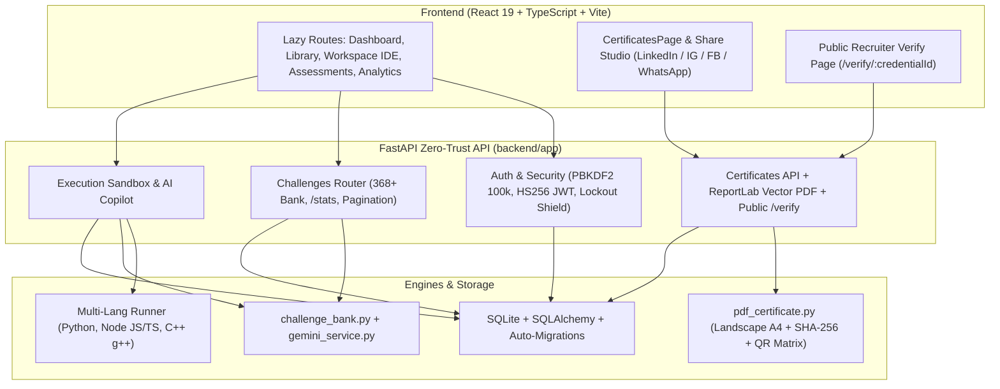
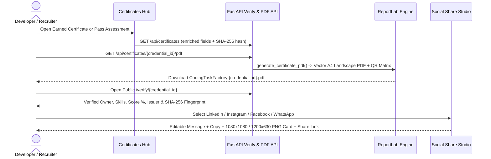
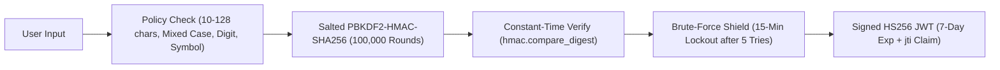

<div align="center">
  

  <h3>AI-Powered Coding Challenge &amp; Developer Assessment Platform</h3>
  <p><em>"Create. Code. Evaluate. Improve."</em> — 368+ Multi-Language Challenges, Context-Aware AI Copilot, Zero-Trust Security, ReportLab Vector PDF Credentials &amp; Harbor 0.25 TaskForge Pipeline</p>

  <p>
    <a href="https://coding-task-factory.vercel.app"></a>
    <a href="wiki/Home.md"></a>
    <a href="#challenge-bank--execution-sandbox"></a>
    <a href="#credentials-vector-pdf--social-share-studio"></a>
    <a href="validation_evidence/mutation_summary.md"></a>
  </p>

  <p>
    <a href="https://github.com/Ranjeet7680/AI-Powered-Coding-Challenge-Developer-Assessment-Platform/wiki"></a>
    <a href="https://github.com/avfoundation/harbor"></a>
    <a href="validation_evidence/validation_summary.md"></a>
    <a href="backend/app/routers/auth.py"></a>
    <a href="https://github.com/Ranjeet7680/AI-Powered-Coding-Challenge-Developer-Assessment-Platform/actions"></a>
    <a href="LICENSE"></a>
  </p>
</div>

---

## 🌟 Executive Summary

This repository delivers a unified dual-capability platform built for the **Innodata AI Hackathon**:

1. **Coding Task Factory Full-Stack SaaS Application**:
   - **368+ Multi-Language Challenges** spanning 10 CS & ML domains with Python, JavaScript, TypeScript, and C++ starter harnesses and automated unit verification.
   - **Interactive Monaco Workspace & AI Copilot** combining live test-case execution, Big-O review, Markdown/LaTeX rendering, and Google Gemini integration (with offline procedural & AST static fallbacks).
   - **Timed Assessments, Analytics & Leaderboard** with live weekly/all-time rankings, interactive assessment screener UI, and 1-click completion grading.
   - **Cryptographic Credentials, ReportLab Vector PDF & Social Post Studio** featuring SHA-256 verification hashes, deterministic 15×15 QR matrices, a public `/verify/:credentialId` registry, high-res ReportLab landscape PDFs, and pre-built sharing workflows for **LinkedIn, Instagram, Facebook, and WhatsApp** (including HTML5 Canvas `1080×1080` & `1200×630` PNG card downloads).
   - **Zero-Trust Auth & Security** enforcing salted 100k-round PBKDF2-HMAC-SHA256 hashing, constant-time checks, brute-force account lockouts, HS256 JWTs, and masked user API key previews.

2. **Track 1 Automated Task Factory Pipeline (`TaskForge`)**:
   - Autonomous SWE benchmark generator built against **`pallets/click`** (`934813e4d421071a1b3db3973c02fe2721359a6e`, v8.1.8) producing 5 substantive feature-development packages compliant with **Harbor 0.25** (`0` lint errors/warnings, `0.0` baseline reward, `1.0` oracle reward, **10/10 mutation kill rate**).

---

## 🗺️ System Architecture Diagram

> Explore full sequence diagrams, database ER models, and module deep dives in the [**Project Wiki**](wiki/Home.md).



---

## 📚 Documentation & GitHub Wiki Directory

| Guide | Summary | Link |
| :--- | :--- | :--- |
| **Wiki Home & Architecture Index** | Ecosystem map & GitHub Wiki sync guide | [`wiki/Home.md`](wiki/Home.md) |
| **System Architecture & ER Schema** | Component topology (`flowchart TB`) & SQLite schema (`erDiagram`) | [`wiki/Architecture.md`](wiki/Architecture.md) |
| **Challenge Bank & Execution Sandbox** | 368+ challenge domains & Python/JS/TS/C++ runner pipeline | [`wiki/Challenge-Bank-and-Execution.md`](wiki/Challenge-Bank-and-Execution.md) |
| **Security, PDF & Social Credentials** | Zero-trust auth sequences, ReportLab PDFs & social share workflows | [`wiki/Security-and-Credentials.md`](wiki/Security-and-Credentials.md) |
| **Track 1 TaskForge Pipeline** | Harbor 0.25 task generation, validation matrix & mutation testing | [`wiki/TaskForge-Pipeline.md`](wiki/TaskForge-Pipeline.md) |
| **Technical Whitepaper & Demo Script** | Detailed architecture report & presentation walkthrough | [`docs/TECHNICAL_EXPLANATION.md`](docs/TECHNICAL_EXPLANATION.md) · [`docs/WALKTHROUGH_DEMO.md`](docs/WALKTHROUGH_DEMO.md) |

---

## 🚀 Challenge Bank & Execution Sandbox

| Domain | Tasks | Highlights |
| :--- | :---: | :--- |
| Arrays & Hashing | 37 | Two Sum, subarray sums, Kadane variants, prefix products |
| Strings & Parsing | 36 | Bracket matching, anagram grouping, token parsers |
| Two Pointers & Sliding Window | 36 | Variable windows, constrained intervals, two-scan arrays |
| Stack & Queue | 36 | Monotonic stacks, sliding window extrema, expression eval |
| Graphs & BFS/DFS | 37 | Shortest path hops, topological order, island traversals |
| Dynamic Programming | 36 | Knapsack optimizations, LIS, coin change, sequence paths |
| Binary Search & Sorting | 36 | Search bounds, rotated scans, interval merges |
| Math & Bitwise | 36 | Fast modular power, XOR parity, primes & combinatorics |
| Design & Systems | 37 | LRU Cache, rate limiters, ring buffers, token buckets |
| Machine Learning | 37 | K-Means clustering, cosine similarity, dot-product norms |

- **Supported Execution Runtimes**: Python 3, JavaScript (Node `.mjs`), TypeScript (Node `--experimental-strip-types`), and C++ (`g++`/`clang++` with structured compilation error reporting).
- **Scalable Browsing UX**: Live category/difficulty counters (`/api/challenges/stats`), Solved/Unsolved filter toggles, 24-card pagination, grid/table switcher, and instant `Ctrl+K` command search.

---

## 🏆 Credentials, Vector PDF & Social Share Studio



---

## 🛡️ Zero-Trust Account Security System

Designed aligned with **NIST SP 800-63B** and **OWASP Authentication Guidelines**:



- **Secret Protection**: User Gemini API keys are stored encrypted/server-side and masked (`has_gemini_api_key` + `gemini_api_key_preview`) across all API responses.
- **Repeat-Solve Guard**: Coding challenges only grant first-solve completion points once per user (`solved_count`), preventing point farming while preserving iterative submission history.

---

## 📊 Track 1 TaskForge Benchmark Scorecard

| Task Package ID | Click Subsystem Extended | Baseline (`nop`) | Oracle (`oracle`) | Regressions Clean | Mutation Kill Rate | Harbor Lint |
| :--- | :--- | :---: | :---: | :---: | :---: | :---: |
| **`click-feature-command-aliases`** | Command Parsing & Dispatch (`core.py`) | `0.0` | `1.0` | Yes | 100% (2/2) | 0 errors |
| **`click-feature-json-help-export`** | Introspection & Formatting (`core.py`) | `0.0` | `1.0` | Yes | 100% (2/2) | 0 errors |
| **`click-feature-nested-envvar-prefix`** | Context & Environment Resolution (`core.py`) | `0.0` | `1.0` | Yes | 100% (2/2) | 0 errors |
| **`click-feature-parameter-deprecation`** | Parameter Lifecycle (`core.py`, `exceptions.py`) | `0.0` | `1.0` | Yes | 100% (2/2) | 0 errors |
| **`click-feature-password-minlen-validator`** | Validation & Terminal UI (`termui.py`, `core.py`) | `0.0` | `1.0` | Yes | 100% (2/2) | 0 errors |
| **OVERALL SYSTEM TOTALS** | **5 Separate Subsystems** | **0.0 (All)** | **1.0 (All)** | **100% Clean** | **10/10 (100.0%)** | **0 Errors / 0 Warnings** |

---

## 📁 Repository Directory Structure

```text
├── wiki/                                           # GitHub Wiki Pages & Mermaid Architecture Diagrams
│   ├── Home.md                                     # Wiki Hub & Ecosystem Mindmap
│   ├── Architecture.md                             # Full-Stack Topology & Database ER Schema
│   ├── Challenge-Bank-and-Execution.md             # 368+ Challenge Bank & Sandbox Runner Guide
│   ├── Security-and-Credentials.md                 # Auth Sequence, ReportLab PDF & Social Share Studio
│   ├── TaskForge-Pipeline.md                       # Track 1 Harbor 0.25 Pipeline Diagrams
│   └── _Sidebar.md                                 # GitHub Wiki Navigation Sidebar
│
├── docs/                                           # Documentation & Animated SVG Headers
│   ├── assets/
│   │   ├── hero-banner.svg                         # Animated README Hero SVG Header
│   │   └── wiki-header.svg                         # Animated Wiki Pipeline SVG Banner
│   ├── TECHNICAL_EXPLANATION.md                    # In-depth architectural paper
│   └── WALKTHROUGH_DEMO.md                         # Video storyboard & script
│
├── backend/                                        # FastAPI Application Server
│   ├── app/
│   │   ├── routers/                                # auth, challenges, execution, ai_generator, assessments, analytics, user, videos
│   │   └── services/
│   │       ├── challenge_bank.py                   # 360+ deterministic multi-language challenge generator
│   │       ├── pdf_certificate.py                  # ReportLab landscape A4 PDF + QR matrix generator
│   │       ├── code_runner.py                      # Subprocess execution sandbox (PY/JS/TS/C++)
│   │       └── gemini_service.py                   # Gemini generator, AI Copilot & procedural fallbacks
│   └── tests/test_api.py                           # Isolated SQLite pytest API & PDF test suite
│
├── frontend/                                       # React 19 + TypeScript + Vite SPA
│   ├── public/                                     # Custom Hex-Forge SVG logo, favicon & OpenGraph card
│   └── src/
│       ├── components/                             # BrandLogo, AppLayout, All-Pages Footer, GlobalSearchModal
│       ├── pages/                                  # Lazy routes incl. ChallengesPage, CertificatesPage, VerifyCertificatePage, WikiPage
│       └── utils/certificateShare.ts               # LinkedIn / IG / FB / WhatsApp post builders & Canvas PNG cards
│
├── api/index.py · vercel.json · requirements.txt   # Vercel Production ASGI + SPA deployment config
├── LICENSE · SECURITY.md · .github/                # MIT License, Security Policy, CI & PR/Issue templates
├── pipeline/ & task_packages/ & validation_evidence/
└── demo_walkthrough.py · validate_tasks.py · run_mutation_testing.py · run_factory.py
```

---

## ⚡ Quick Start & Verification

### 1. Run Full-Stack Web Platform

**Start FastAPI Backend:**
```bash
cd backend
pip install -r requirements.txt
python -m uvicorn app.main:app --host 127.0.0.1 --port 8000 --reload
```
- API & Interactive Swagger Docs: `http://127.0.0.1:8000/docs`

**Start React Frontend:**
```bash
cd frontend
npm install
npm run dev -- --host 127.0.0.1 --port 5173
```
- Application URL: `http://localhost:5173`
- Verified Demo Login: `developer@codingtaskfactory.io` / `Developer@2026!`

### 2. Run Automated Test, Lint & Build Checks
```bash
# Backend API, Sandbox, Challenge Bank & ReportLab PDF Suite
pytest backend/tests/test_api.py -v

# Frontend Lint (oxlint), TypeScript Type-Check & Production Bundle
cd frontend && npm run lint && npx tsc --noEmit && npm run build
```

### 3. Run Track 1 Harbor & Mutation Verification
```bash
python demo_walkthrough.py
python validate_tasks.py
python run_mutation_testing.py
```

---

## 📄 License
Open-sourced under the MIT License. The Track 1 foundation repository `pallets/click` is licensed under the BSD-3-Clause License.
