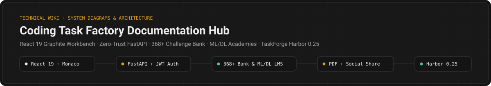
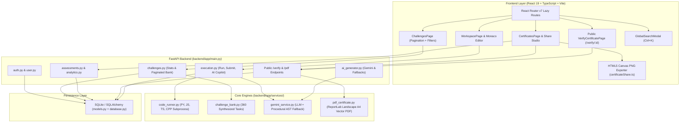
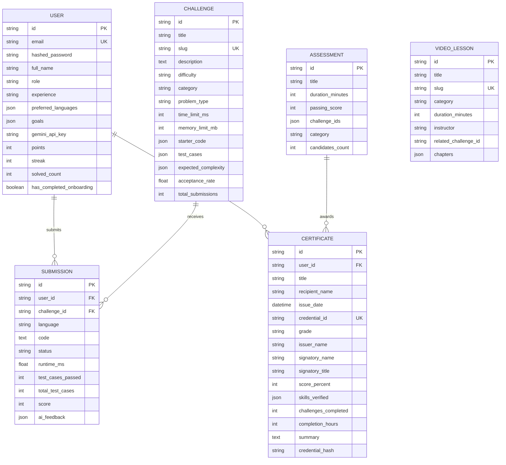

  

# System Architecture & Database Schema

[← Back to Wiki Home](Home.md)

---

## Full-Stack System Topology

The web platform separates a **code-split React 19 SPA** from a **stateless JWT-authenticated FastAPI backend**, backed by SQLAlchemy + SQLite with idempotent runtime column migrations (`ensure_schema_migrations`).

---

## Database Entity-Relationship Schema

All relational models are defined in [`backend/app/models.py`](../backend/app/models.py) with automatic additive SQLite migrations handled on startup via `ensure_schema_migrations()` in [`backend/app/database.py`](../backend/app/database.py).

