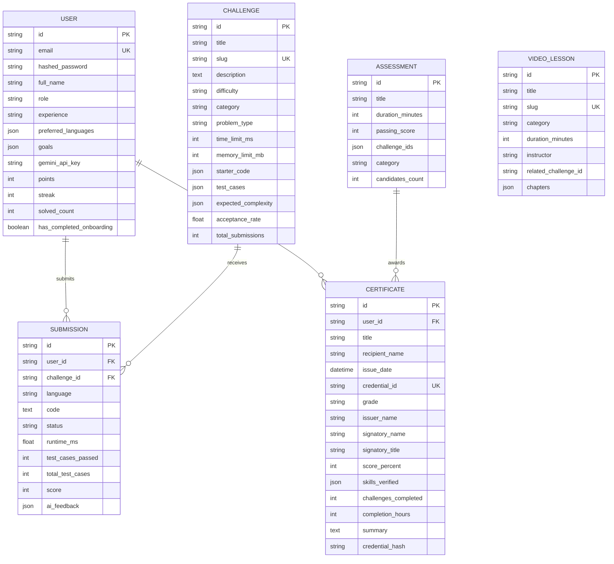
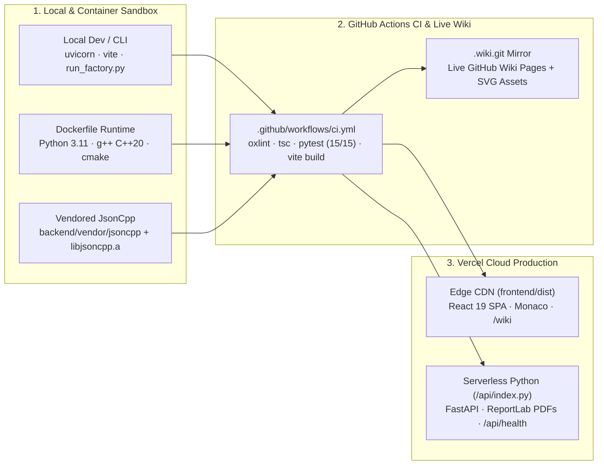

  

# System Architecture & Database Schema

[← Back to Wiki Home](Home.md)

---

## Full-Stack System Topology

The web platform separates a **code-split React 19 Graphite Workbench SPA** from a **stateless JWT-authenticated FastAPI backend**, backed by SQLAlchemy + SQLite with idempotent runtime column migrations (`ensure_schema_migrations`).

```mermaid
flowchart TB
  subgraph Client["Frontend Layer (React 19 + TypeScript + Vite)"]
    Router["React Router v7 Lazy Routes (26 Views)"]
    Landing["LandingPage + CodeGlyphField Canvas"]
    IDE["WorkspacePage & Monaco Editor"]
    Academies["5 Academies (230 Lectures: ML, DL, DS, IITM Biz, Agentic AI) + CourseShare + Proctor"]
    CertsUI["CertificatesPage & Share Studio"]
    VerifyUI["Public Verify (/verify/:id) & OG Course Share (/share/course/:track)"]
    Search["GlobalSearchModal (Ctrl+K)"]
    CanvasPNG["HTML5 Canvas PNG Exporters (certificateShare.ts & courseShare.ts)"]
  end

  subgraph API["FastAPI Backend (backend/app/main.py)"]
    AuthR["auth.py & user.py"]
    ChalR["challenges.py (Stats & Paginated Bank)"]
    ExecR["execution.py (Run, Submit, AI Copilot)"]
    GenR["ai_generator.py (Gemini & Fallbacks)"]
    CourseR["ml_course.py & videos.py (5 LMS Routers, Proctor, OG Share, Playlists)"]
    AssessR["assessments.py, analytics.py & submissions.py"]
    CertR["Public /verify & /pdf Endpoints"]
  end

  subgraph Services["Core Engines (backend/app/services/)"]
    Runner["code_runner.py (PY, JS, TS, CPP20 JsonCpp)"]
    Bank["challenge_bank.py (360 Synthesized Tasks)"]
    Catalog["course_catalog_shared.py · ml/dl/ds/biz/agentic catalogs · video_library.py"]
    Gemini["gemini_service.py (LLM + Procedural AST Fallback)"]
    PDF["pdf_certificate.py (ReportLab Landscape A4 Vector PDF)"]
  end

  subgraph Storage["Persistence Layer"]
    DB["SQLite / SQLAlchemy (models.py + database.py)"]
  end

  Router --> Landing & IDE & Academies & CertsUI & VerifyUI & Search
  CertsUI --> CanvasPNG
  IDE --> ExecR
  Academies --> CourseR
  CertsUI --> AssessR & CertR
  VerifyUI --> CertR

  AuthR & ChalR & AssessR & CourseR & CertR --> DB
  ExecR --> Runner & Gemini & DB
  GenR --> Gemini
  ChalR --> Bank
  CourseR --> Catalog
  CertR --> PDF
```

---

## Frontend UI System (Graphite & Signal Amber Workbench)

All 22 frontend pages and shared layout shells follow a unified architectural specification:

- **Surface Hierarchy (`frontend/src/index.css`)**: Deepest rail `#0f0f10`, Canvas `#141415`, Card `#19191b`, Raised `#222225`, separated by `1px` low-contrast hairlines (`rgba(237, 237, 237, 0.08)`) with zero ambient glow blurs.
- **Typography & Tabular Discipline (`frontend/index.html`)**: `IBM Plex Sans` (weights `400`, `500`, `600`) paired with `IBM Plex Mono` (`400`, `500`) and `.tabular-nums` on every metric, countdown, rank, and table cell.
- **Accent & Semantics**: Monochrome primary action surface (`#ededed` text on `#141415` or inverse dark button), single **Signal Amber (`#e5a00d`)** focal accent for primary chart trajectories and active markers, `#4cc38a` positive, and `#e5484d` error/negative.
- **Pure-Code Visuals**: Interactive `CodeGlyphField.tsx` ASCII glyph backdrop and live interactive `lru_cache` code preview (`LandingPage.tsx`), flat drafted `< / >` vector mark (`BrandLogo.tsx`, `favicon.svg`, `logo.svg`, `og-card.svg`), and Graphite-themed Recharts & SVG curriculum thumbnails (`ml-ctf-course-thumbnail.svg`, `stanford-ctf-dl-thumbnail.svg`).

---

## Database Entity-Relationship Schema

All relational models are defined in [`backend/app/models.py`](../backend/app/models.py) with automatic additive SQLite migrations handled on startup via `ensure_schema_migrations()` in [`backend/app/database.py`](../backend/app/database.py).

---

## Multi-Environment Deployment, C++20 JsonCpp & CI/CD Architecture

Shows how the platform deploys consistently across Local/Docker sandboxes (including C++20 `open-source-parsers/jsoncpp`), GitHub Actions CI + live Wiki mirror, and Vercel Edge/Serverless production.

