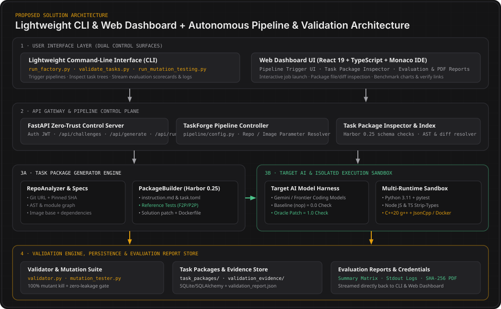
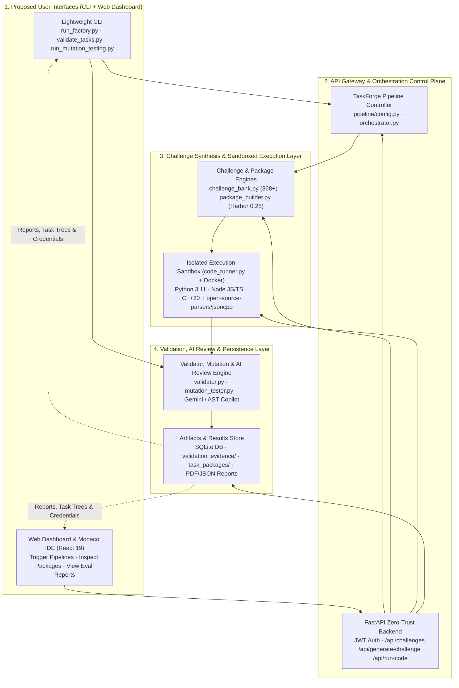
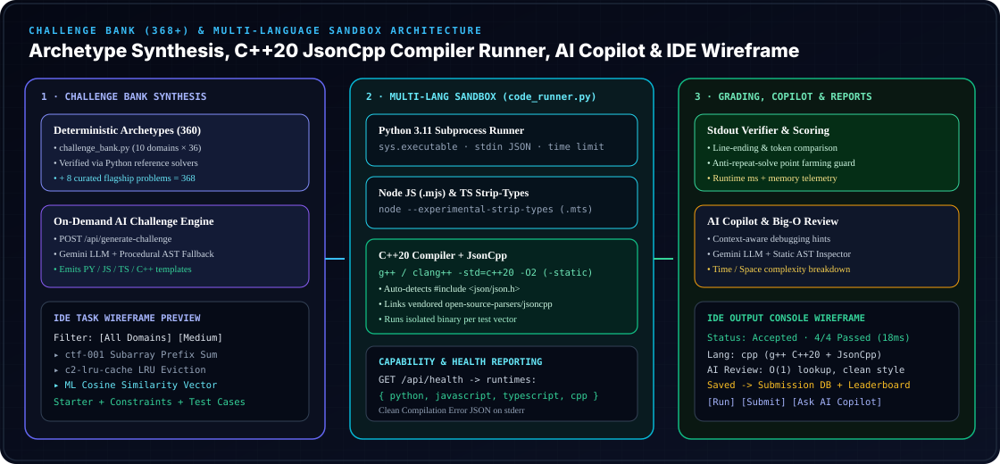
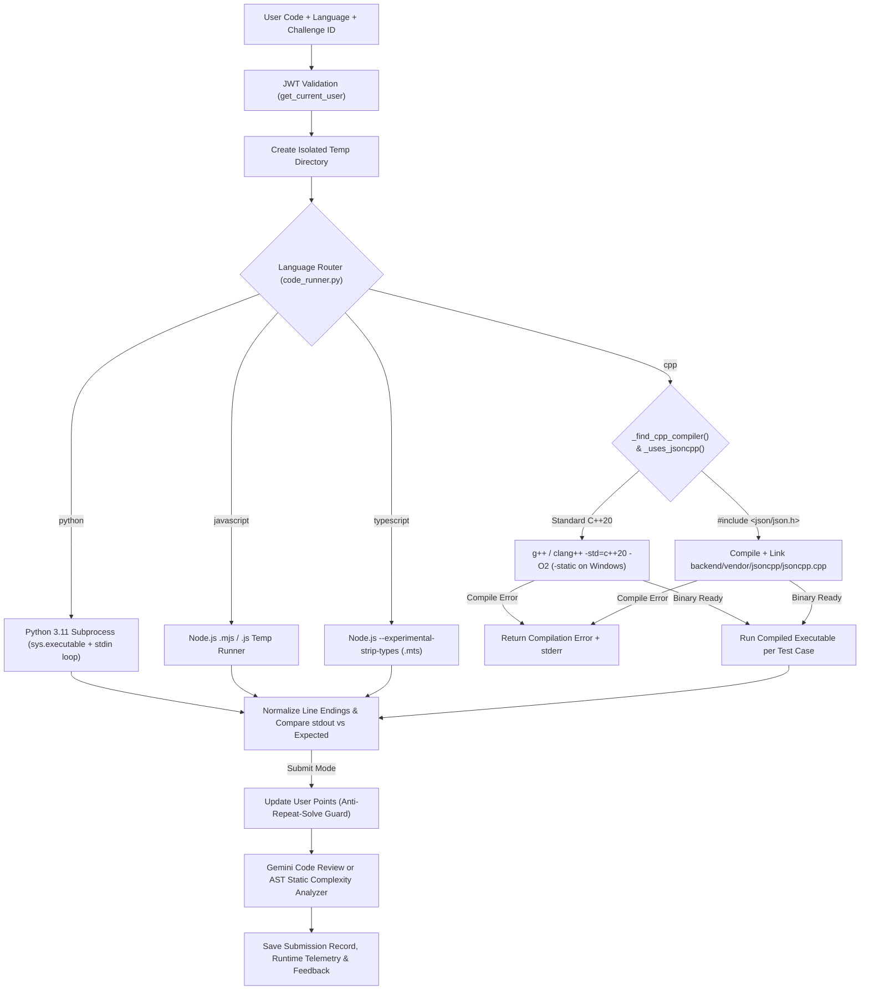
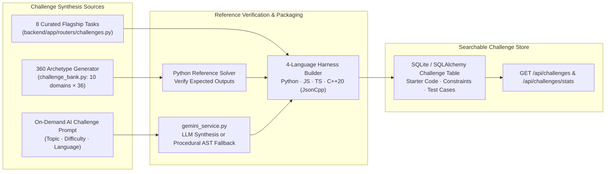

<div align="center">
  
</div>

# Challenge Bank (368+) & Multi-Language Execution Sandbox

[← Back to Wiki Home](Home.md) · [Proposed Solution Arch & Wireframes →](Proposed-Solution-Architecture-and-Wireframes.md)

---

## Architecture Diagrams of the Proposed Solution (3 Diagrams)

This page details the **three core architecture diagrams** powering the proposed Coding Task Factory platform—from the dual CLI / Web Dashboard control surfaces down through the 368+ Challenge Bank synthesizer and isolated C++20 (`open-source-parsers/jsoncpp`) / Python / Node execution sandbox.

<div align="center">
  
</div>

---

### Architecture Diagram 1: Proposed Solution Full-Stack & Dual-Interface Architecture

Connects the **lightweight CLI** and **Web Dashboard UI** (triggering generation pipelines, inspecting task packages, viewing evaluation reports) to the **Zero-Trust FastAPI Control Plane**, **368+ Challenge & TaskForge Synthesizers**, **Isolated Multi-Lang Sandbox**, and **Validation / Evidence Store**.



---

### Architecture Diagram 2: Multi-Language Sandbox & C++20 JsonCpp Execution Architecture

Shows how incoming user submissions and benchmark tests are authenticated, isolated per invocation, routed across **Python**, **JavaScript**, **TypeScript**, and **C++20 (`open-source-parsers/jsoncpp`)**, compared deterministically, and graded with AI code feedback.

<div align="center">
  
</div>



---

### Architecture Diagram 3: 368+ Challenge Bank Synthesis & AI Generator Architecture

Shows how **8 curated flagship tasks**, **360 deterministic archetype challenges** (verified against Python reference solvers), and **on-demand Gemini AI challenges** converge into standardized 4-language problem packages served via `/api/challenges`.



---

## Multi-Domain Challenge Bank Composition

The platform ships **368** distinct, runnable coding problems combining **8 curated core tasks** in [`backend/app/routers/challenges.py`](../backend/app/routers/challenges.py) with **360 deterministic archetype-synthesized challenges** (`ctf-001` through `ctf-360`, 36 per category) generated by [`backend/app/services/challenge_bank.py`](../backend/app/services/challenge_bank.py).

Every problem ships:
- Starter templates in **4 languages**: `python`, `javascript`, `typescript`, and `cpp` (C++20 with `open-source-parsers/jsoncpp`)
- Exact `test_cases` verified programmatically against Python reference solvers at generation time
- Algorithmic hints, constraints, examples, and target Big-O time/space complexity

| Category | Count | Representative Topics |
| :--- | :---: | :--- |
| **Arrays & Hashing** | 37 | Subarray sums, frequency indexing, Kadane variants, prefix products |
| **Strings & Parsing** | 36 | Anagram grouping, expression parsers, delimiter balancing, pattern matching |
| **Two Pointers & Sliding Window** | 36 | Variable-window substrings, pair-sum scanners, container geometry |
| **Stack & Queue** | 36 | Monotonic stacks, valid bracket trees, sliding extrema queues |
| **Graphs & BFS/DFS** | 37 | Topological reachability, connected grids, shortest hops |
| **Dynamic Programming** | 36 | Knapsack optimizations, edit paths, LIS, house robber & coin combinations |
| **Binary Search & Sorting** | 36 | Rotated array bounds, monotonic predicate search, interval merging |
| **Math & Bitwise** | 36 | Modular exponentiation, XOR parity tricks, GCD/LCM & primes |
| **Design & Systems** | 37 | LRU Cache, rate limiters, ring buffers, token buckets |
| **Machine Learning** | 37 | K-Means centroids, cosine similarity, dot-product norms, gradient steps |
| **Total Seeded Library** | **368** | **All filterable via `/api/challenges/stats` & paginated UI** |

---

## Workspace IDE & AI Copilot Runtime Sequence

```mermaid
sequenceDiagram
  autonumber
  actor Dev as Developer (Monaco Workspace IDE)
  participant API as FastAPI (execution.py)
  participant Sandbox as code_runner.py (PY/JS/TS/C++ JsonCpp)
  participant Copilot as Gemini / AST Review Engine
  participant DB as SQLite Submissions &amp; Stats

  Dev->>API: POST /api/run-code (code, language, challenge_id)
  API->>Sandbox: Execute sample test cases inside temp sandbox
  Sandbox-->>API: Per-case stdout, runtime_ms, status (Accepted / Error)
  API-->>Dev: Live Console Result + Pass/Fail Breakdown

  opt Developer requests debugging hint
    Dev->>API: POST /api/ai-copilot (code, error_output)
    API->>Copilot: Analyze logic &amp; complexity against problem spec
    Copilot-->>API: Targeted hint + Big-O guidance
    API-->>Dev: Copilot feedback panel
  end

  Dev->>API: POST /api/submit-solution (code, language, challenge_id)
  API->>Sandbox: Grade full public + hidden test suite
  Sandbox-->>API: Score, test_cases_passed, total_test_cases
  API->>Copilot: Generate post-submission code review
  API->>DB: Persist Submission &amp; increment points if first Accepted solve
  DB-->>API: Updated streak &amp; leaderboard standing
  API-->>Dev: Verified verdict + AI code review + updated score
```

---

## Runtime Capability Detection

`get_runtime_capabilities()` inspects local toolchain availability (`python3`/`python`, `node`, Node experimental TypeScript stripping, and C++ compilers via `_find_cpp_compiler()` bundled with amalgamated `open-source-parsers/jsoncpp`) and exposes live readiness through `GET /api/health`. Missing optional native compilers return clean, actionable `Compilation Error` responses rather than HTTP 500 crashes.
