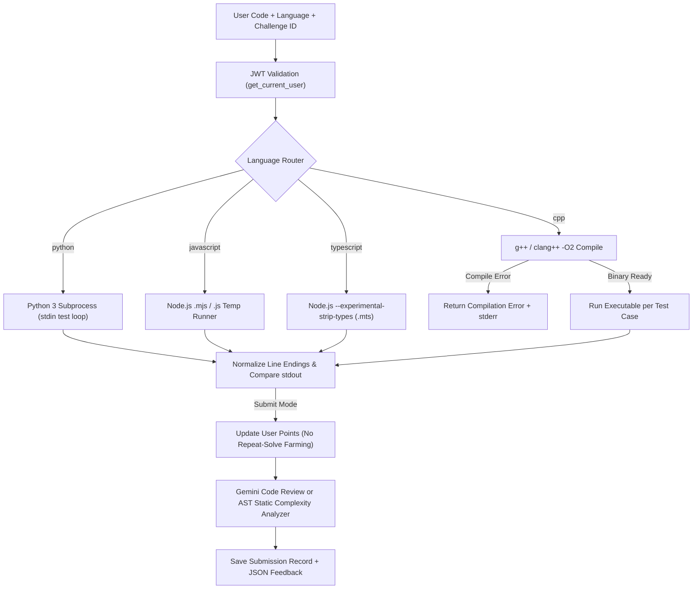

  

# Challenge Bank (368+) & Multi-Language Execution Sandbox

[← Back to Wiki Home](Home.md)

---

## Multi-Domain Challenge Bank Composition

The platform ships **368** distinct, runnable coding problems combining **8 curated core tasks** in [`backend/app/routers/challenges.py`](../backend/app/routers/challenges.py) with **360 deterministic archetype-synthesized challenges** (`ctf-001` through `ctf-360`, 36 per category) generated by [`backend/app/services/challenge_bank.py`](../backend/app/services/challenge_bank.py).

Every problem ships:
- Starter templates in **4 languages**: `python`, `javascript`, `typescript`, and `cpp`
- Exact `test_cases` verified programmatically against Python reference solvers at generation time
- Algorithmic hints, constraints, examples, and target Big-O time/space complexity

| Category | Count | Representative Topics |
| :--- | :---: | :--- |
| **Arrays & Hashing** | 37 | Subarray sums, frequency indexing, Kadane variants, prefix products |
| **Strings & Parsing** | 36 | Anagram grouping, expression parsers, delimiter balancing, pattern matching |
| **Two Pointers & Sliding Window** | 36 | Variable-window substrings, pair-sum scanners, container geometry |
| **Stack & Queue** | 36 | Monotonic stacks, valid bracket trees, sliding extrema queues |
| **Graphs & BFS/DFS** | 37 | Topological reachability, connected grids, shortest hops |
| **Dynamic Programming** | 36 | Knapsack optimizations, edit paths, LIS, house robber & coin combinations |
| **Binary Search & Sorting** | 36 | Rotated array bounds, monotonic predicate search, interval merging |
| **Math & Bitwise** | 36 | Modular exponentiation, XOR parity tricks, GCD/LCM & primes |
| **Design & Systems** | 37 | LRU Cache, rate limiters, ring buffers, token buckets |
| **Machine Learning** | 37 | K-Means centroids, cosine similarity, dot-product norms, gradient steps |
| **Total Seeded Library** | **368** | **All filterable via `/api/challenges/stats` & paginated UI** |

---

## Code Execution & AI Copilot Flow

---

## Runtime Capability Detection

`get_runtime_capabilities()` inspects local toolchain availability (`python3`/`python`, `node`, Node experimental TypeScript stripping, `g++`/`clang++`) and exposes live readiness through `GET /api/health`. Missing optional native compilers return clean, actionable `Compilation Error` responses rather than HTTP 500 crashes.
