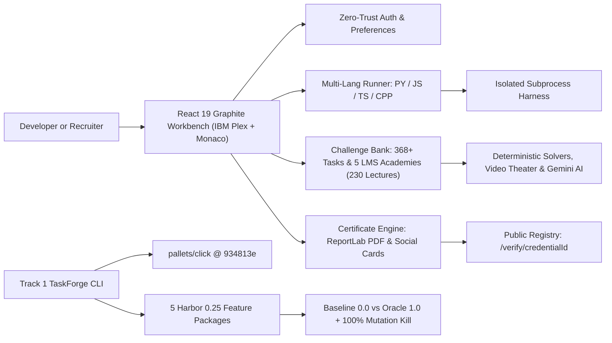

<div align="center">
  
</div>

# Coding Task Factory & TaskForge — Official Wiki

Welcome to the technical wiki for the **AI-Powered Coding Challenge & Developer Assessment Platform** (Innodata AI Hackathon). This platform combines an **autonomous SWE benchmark synthesis pipeline (TaskForge)** with a **Graphite & Signal Amber web workbench spanning algorithmic challenges, a multi-language IDE, AI Copilot, 5 certified LMS academies (230 lectures across ML, Stanford DL, Data Science, IIT Madras Business Fundamentals & Agentic AI) with Thumbnail Social Sharing & MediaPipe proctoring, and verifiable PDF/Social credentials**.

---

## Navigation Index

| Wiki Page | Focus Area | Diagrams Included |
| :--- | :--- | :--- |
| [**Proposed Solution Architecture & Wireframes**](Proposed-Solution-Architecture-and-Wireframes.md) | Lightweight CLI + Web Dashboard wireframes (trigger pipeline, inspect packages, view reports) & full solution architecture | Solution Architecture (`SVG` + `flowchart TB`) + CLI & Dashboard Wireframes (`SVG` + ASCII) |
| [**Process Flow, Use-Case & Architecture**](Process-Flow-and-Use-Case.md) | Repo specs/image params -> task packages + reference tests -> target AI models -> validated outputs | Process Flow (`flowchart TD`) + UML Use-Case (`flowchart LR`) + Architecture (`flowchart TB`) |
| [**System Architecture & ER Schema**](Architecture.md) | Full-stack topology, Graphite UI system, lazy routes, FastAPI routers, SQLite migrations & CI/CD deployment | System Topology (`flowchart TB`) + Database Schema (`erDiagram`) + CI/CD Deployment (`flowchart LR`) |
| [**5 LMS Academies, Course Share & AI Proctoring**](ML-Course-and-AI-Proctoring.md) | ML (106), Stanford DL (21), Data Science (14), IITM Business (66), Agentic AI (23), Thumbnail Share (`1280×720` PNG + OG) & MediaPipe 4-tier guard | Big LMS SVG + 3 Big Diagrams (9-Stage Flow, AI Proctor Vision, 5-Track Curriculum & API) |
| [**Challenge Bank & Execution Sandbox**](Challenge-Bank-and-Execution.md) | 368+ curated challenges across 10 domains, Python/JS/TS/C++20 JsonCpp runner, Gemini Copilot | 3 Proposed Solution Architecture Diagrams + IDE Wireframe SVG + Copilot Sequence |
| [**Zero-Trust Security, PDF & Social Credentials**](Security-and-Credentials.md) | PBKDF2-HMAC-SHA256, HS256 JWT, ReportLab vector PDFs, public `/verify/:id`, LinkedIn/IG/FB/WA cards | Auth Sequence Diagram + Certificate Issuance & Verification Sequence |
| [**Track 1 TaskForge Harbor Pipeline**](TaskForge-Pipeline.md) | Autonomous feature synthesis on `pallets/click` v8.1.8, Harbor 0.25 linting & mutation testing | TaskForge Synthesis Flow (`flowchart LR`) + Mutation & Zero-Leakage Validation Matrix (`flowchart TD`) |

---

## High-Level Ecosystem Map



---

## Syncing to the Standalone GitHub Wiki Tab

These documentation pages live cleanly inside `wiki/` for version-controlled PR review alongside code. Publish or refresh GitHub's companion `.wiki.git` remote directly with:

```bash
git clone https://github.com/Ranjeet7680/AI-Powered-Coding-Challenge-Developer-Assessment-Platform.wiki.git ../ctf-wiki
cp wiki/*.md ../ctf-wiki/
cp -r docs ../ctf-wiki/
cd ../ctf-wiki && git add . && git commit -m "docs(wiki): sync updated wiki and Graphite UI documentation" && git push
```
