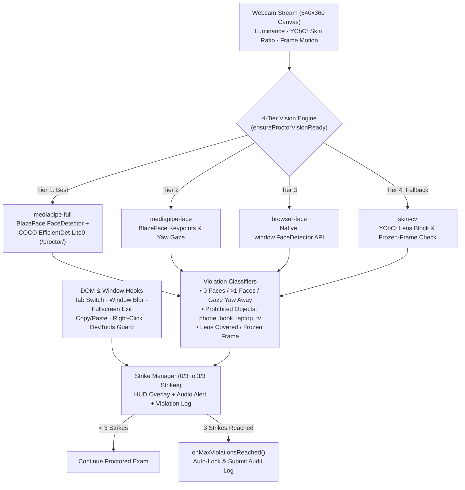
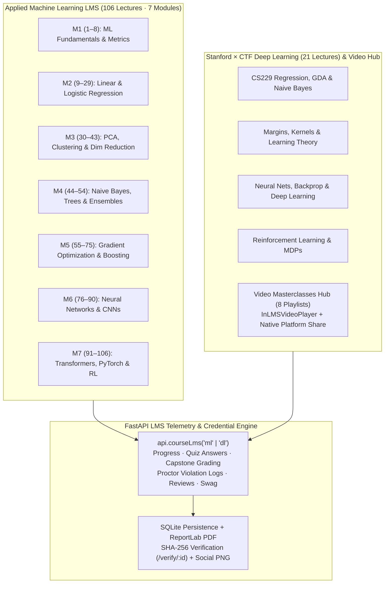

  

# Machine Learning (106) & Stanford DL (21) LMS + AI Proctoring Architecture

[← Back to Wiki Home](Home.md) · [Proposed Solution Arch & Wireframes →](Proposed-Solution-Architecture-and-Wireframes.md)

---

## 3 Big ML & AI Proctoring Architecture Diagrams

  

---

### Big Diagram 1: End-to-End 9-Stage ML & Deep Learning LMS Progression

Documents the complete page-by-page learning lifecycle across [`LMSHubPage.tsx`](../frontend/src/pages/LMSHubPage.tsx), [`CourseDetailPage.tsx`](../frontend/src/pages/CourseDetailPage.tsx), [`MLCoursePage.tsx`](../frontend/src/pages/MLCoursePage.tsx), [`CourseEndToEndPanels.tsx`](../frontend/src/components/lms/CourseEndToEndPanels.tsx), and [`CourseAdvancedPanels.tsx`](../frontend/src/components/lms/CourseAdvancedPanels.tsx).

```mermaid
flowchart LR
  S1["01 · LMS Courses Hub<br/>(/app/lms · ML & DL Tracks)"] --> S2["02 · Course Detail & Syllabus<br/>(/app/course/ml or /app/course/dl)"]
  S2 --> S3["03 · Lecture Theater<br/>(Step 1: Watch In-LMS Video<br/>Step 2: Notes & Code · +15 XP)"]
  S3 --> S4["04 · Practice Quiz Bank<br/>(Step 3: 100+ ML / 20+ DL MCQs)"]
  S4 --> S5["05 · Capstone Project Lab<br/>(Hands-on Model & Code Grading)"]
  S5 --> S6["06 · Proctored Final Exam<br/>(35 Timed Qs · AI Camera Guard)"]
  S6 --> S7["07 · Feedback Survey<br/>(5-Star Rating & Review)"]
  S7 --> S8["08 · Verified PDF Certificate<br/>(ReportLab A4 · SHA-256 · QR + Social)"]
  S8 --> S9["09 · Goodies Form & Done!<br/>(Swag Claim & Completion Milestone)"]

  S3 -. "Next Lecture / Next Quiz" .-> S4
```

---

### Big Diagram 2: MediaPipe AI Camera Proctor & 4-Tier Anti-Cheat Vision Pipeline

Documents the browser-side computer-vision proctoring engine implemented inside [`ProctorCameraGuard.tsx`](../frontend/src/components/lms/ProctorCameraGuard.tsx) and [`proctorVision.ts`](../frontend/src/components/lms/proctorVision.ts).

---

### Big Diagram 3: Applied ML (106 Lectures) & Stanford DL (21) Curriculum & Backend Telemetry Architecture

Documents the 7 ML modules, 4 Stanford DL CS229 modules, Video Masterclasses theater, and the FastAPI / SQLite backend API (`api.courseLms('ml' | 'dl')`).

---

## ML & DL Module Matrix

| Track | Modules | Lectures & Assessments | Proctoring & Output |
| :--- | :---: | :--- | :--- |
| **Applied ML Course LMS** | **7 Modules** | 106 lectures, 100+ quizzes, 3 capstone labs, 35-question final exam | Live MediaPipe AI camera + 3-strike lock + PDF certificate & goodies |
| **Stanford × CTF Deep Learning** | **4 Modules** | 21 Stanford CS229 lectures, study notes, 20+ quizzes, capstone lab | Proctored final exam + feedback survey + verified credential |
| **Video Masterclasses Hub** | **8 Playlists** | Embedded playlists with platform video theater & direct link sharing | Linked directly to related coding challenges & LMS pathways |
