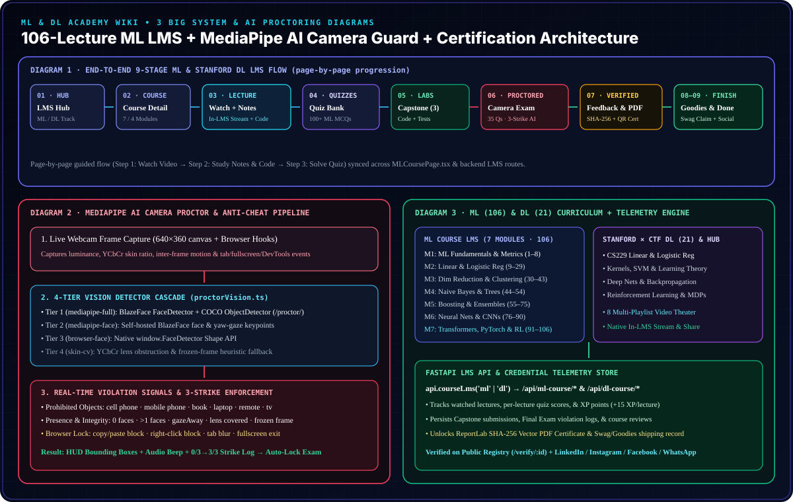
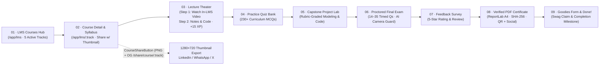
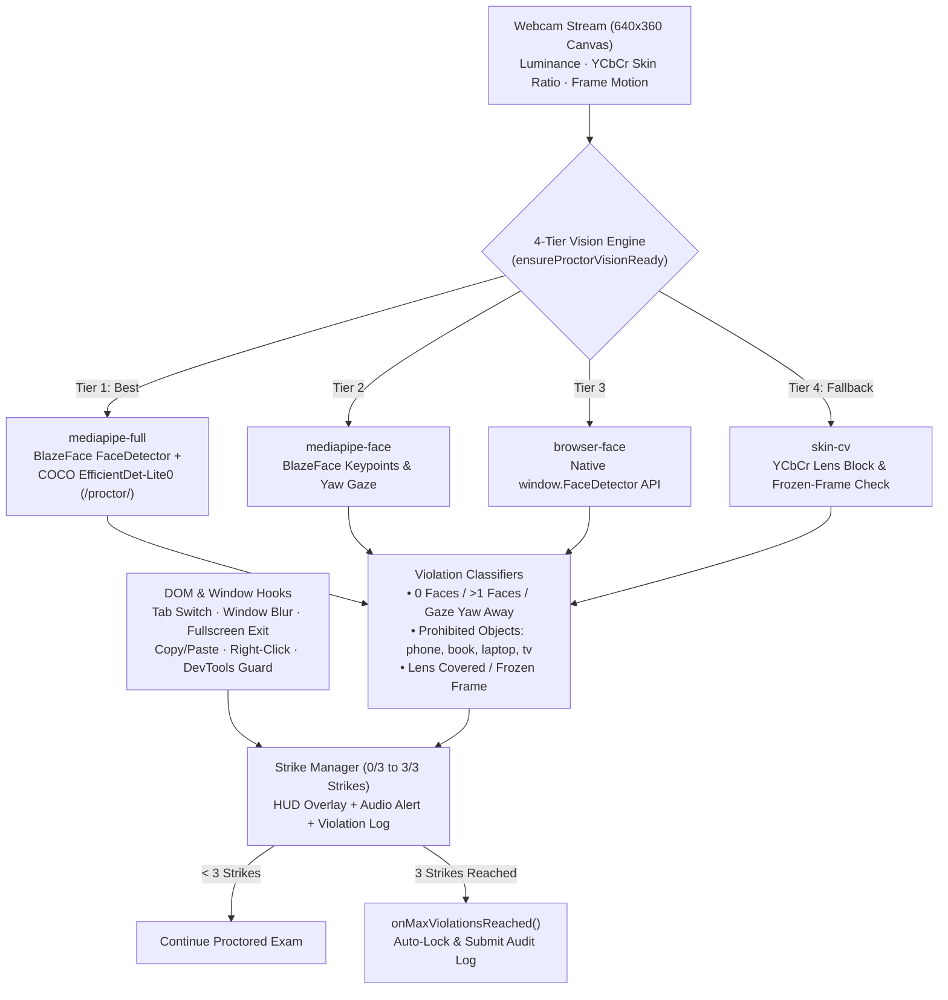
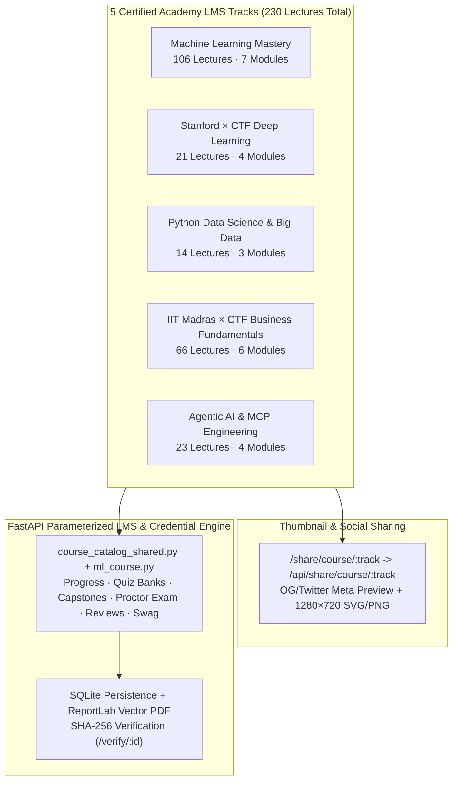

  

# 5 LMS Academies (230 Lectures), Course Thumbnail Share & AI Proctoring Architecture

[← Back to Wiki Home](Home.md) · [Proposed Solution Arch & Wireframes →](Proposed-Solution-Architecture-and-Wireframes.md)

---

## Architecture Overview & 5-Track Ecosystem

  

---

### Big Diagram 1: End-to-End 9-Stage Multi-Track LMS Progression & Course Thumbnail Sharing

Documents the shared page-by-page classroom lifecycle powered by [`courseTracks.ts`](../frontend/src/constants/courseTracks.ts), [`LMSHubPage.tsx`](../frontend/src/pages/LMSHubPage.tsx), [`CourseDetailPage.tsx`](../frontend/src/pages/CourseDetailPage.tsx), [`MLCoursePage.tsx`](../frontend/src/pages/MLCoursePage.tsx), [`CourseShareButton.tsx`](../frontend/src/components/lms/CourseShareButton.tsx), [`CourseEndToEndPanels.tsx`](../frontend/src/components/lms/CourseEndToEndPanels.tsx), and [`CourseAdvancedPanels.tsx`](../frontend/src/components/lms/CourseAdvancedPanels.tsx).

---

### Big Diagram 2: MediaPipe AI Camera Proctor & 4-Tier Anti-Cheat Vision Pipeline

Documents the browser-side computer-vision proctoring engine implemented inside [`ProctorCameraGuard.tsx`](../frontend/src/components/lms/ProctorCameraGuard.tsx) and [`proctorVision.ts`](../frontend/src/components/lms/proctorVision.ts).

---

### Big Diagram 3: 5-Academy Curriculum (`230` Lectures), Shared Catalog Engine & FastAPI Telemetry Architecture

Documents the 5 structured certification tracks, Video Masterclasses theater, and the parameterized FastAPI / SQLite backend (`api.courseLms('ml' | 'dl' | 'ds' | 'biz' | 'agentic')` + `/api/share/course/{track}`).

---

## Complete Academy Module Matrix

| Track | Modules | Lectures & Assessments | Proctoring & Output |
| :--- | :---: | :--- | :--- |
| **Applied ML Course LMS** (`/ml-course`) | **7 Modules** | 106 lectures, 100+ quizzes, 3 capstones, 35-question exam | Live MediaPipe AI camera + 3-strike lock + `CTF-ML-` PDF & swag |
| **Stanford × CTF Deep Learning** (`/dl-course`) | **4 Modules** | 21 CS229 lectures, study notes, 20+ quizzes, 3 capstones, 20-Q exam | Proctored exam + feedback + `CTF-DL-` PDF certificate |
| **Python Data Science & Big Data** (`/ds-course`) | **3 Modules** | 14 lectures (Jupyter, NumPy, Pandas, CSV/JSON, Matplotlib), 14 quizzes, 3 capstones, 14-Q exam | Proctored exam + `CTF-DS-` PDF certificate + PNG share |
| **IIT Madras × CTF Business Fundamentals** (`/biz-course`) | **6 Modules** | 66 lectures (Viz, Bayes, Elasticity, VIF, DEA frontiers, Conjoint), 66 quizzes, 3 capstones, 30-Q exam | Proctored exam + `CTF-BIZ-` PDF certificate + PNG share |
| **Agentic AI & MCP Engineering** (`/agentic-course`) | **4 Modules** | 23 lectures (Reflex/RL Agents, LangGraph, CrewAI, Agno RAG, Custom MCP, OpenAI SDK), 23 quizzes, 3 capstones, 20-Q exam | Proctored exam + `CTF-AG-` PDF certificate + PNG share |
| **Video Masterclasses Hub** (`/videos`) | **8 Playlists** | 596 embedded playlists with platform video theater & direct share | Linked to coding challenges & all 5 Academy pathways |
