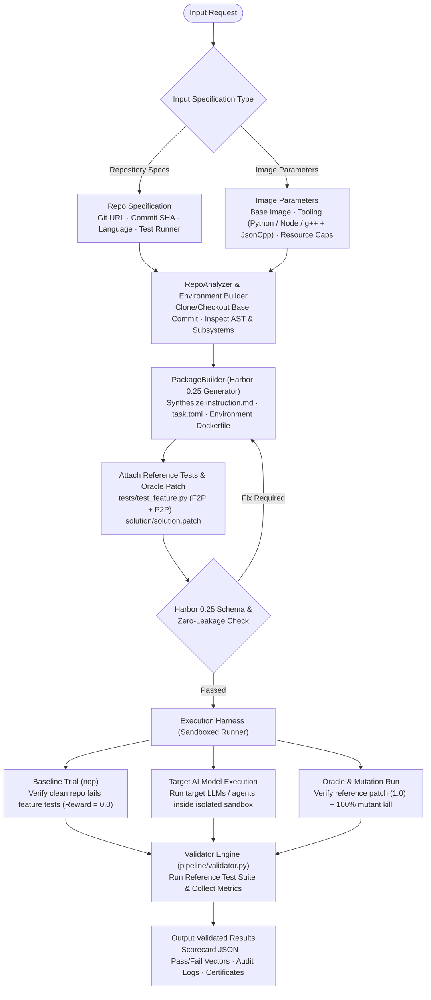
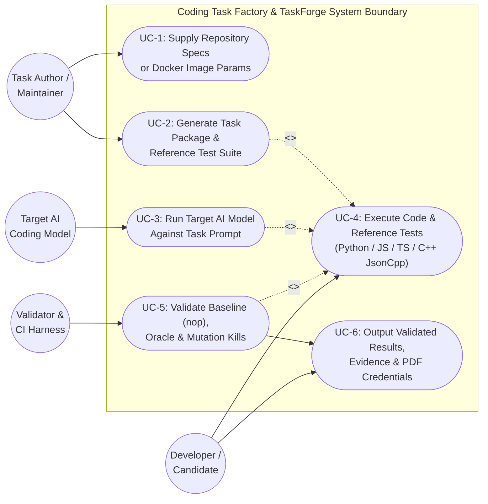
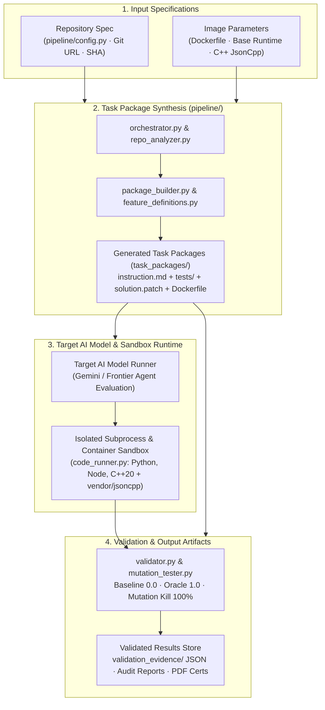

  

# Pipeline Process Flow, Use-Case & Architecture Diagrams

[← Back to Wiki Home](Home.md)

---

## 1. End-to-End Pipeline Process Flow Diagram

The Coding Task Factory (`TaskForge` + Sandbox) pipeline accepts **repository specifications** (Git URL, pinned commit SHA, language, test runner) or **container image parameters** (base image, C++/Python dependencies such as `open-source-parsers/jsoncpp`, runtime limits), synthesizes self-contained **task packages with reference tests**, executes **target AI models**, and emits **validated benchmark results & artifacts**.

---

## 2. System Use-Case Diagram

Shows actors interacting with core capabilities across task ingestion, AI model benchmarking, multi-language sandbox execution (Python, JS, TS, C++20 with `jsoncpp`), and validated result reporting.

---

## 3. High-Level Pipeline Architecture Diagram

