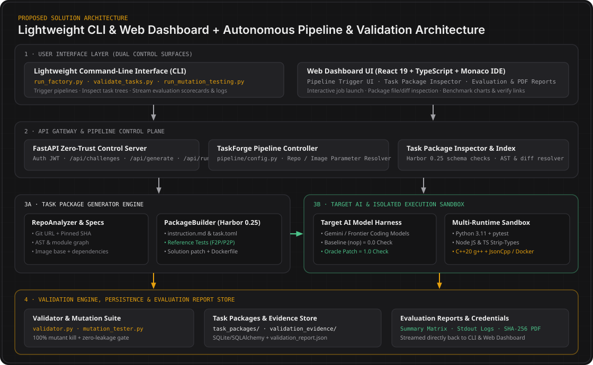
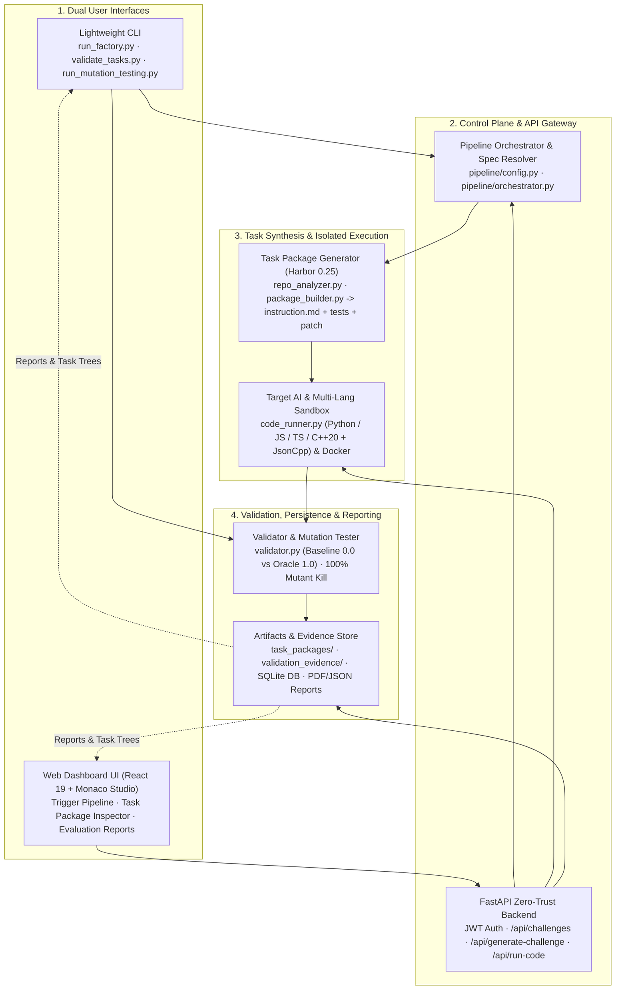
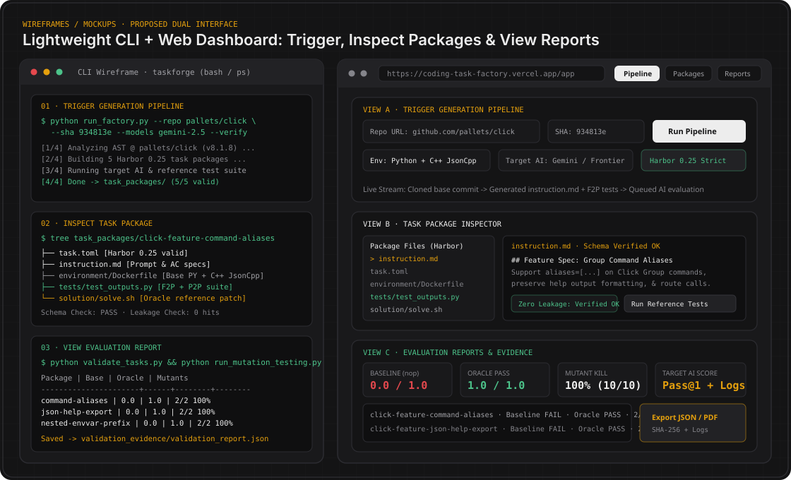

<div align="center">
  
</div>

# Proposed Solution Architecture & CLI / Web Dashboard Wireframes

[← Back to Wiki Home](Home.md) · [Process Flow & Use-Case Diagrams →](Process-Flow-and-Use-Case.md)

---

## 1. Architecture Diagram of the Proposed Solution

The proposed platform pairs a **dual control surface** (**Lightweight CLI** + **Web Dashboard UI**) with an **API Control Plane**, an **Autonomous TaskForge Package Generator**, an **Isolated Multi-Runtime Execution Sandbox** (Python 3.11, Node JS/TS, C++20 with `open-source-parsers/jsoncpp`, and container targets), and a **Validation & Reporting Engine**.

<div align="center">
  
</div>

### Mermaid Interactive System Architecture



### Component-to-Codebase Mapping

| Layer | Responsibility | Concrete Repository Implementation |
| :--- | :--- | :--- |
| **Lightweight CLI** | Trigger generation pipelines, inspect task folders, and run validation/mutation reports from terminal or CI | [`run_factory.py`](../run_factory.py), [`validate_tasks.py`](../validate_tasks.py), [`run_mutation_testing.py`](../run_mutation_testing.py), [`demo_walkthrough.py`](../demo_walkthrough.py) |
| **Web Dashboard UI** | Interactive browser workspace for launching tasks, inspecting problem/starter harnesses, running code, and viewing reports & credentials | [`frontend/src/pages/`](../frontend/src/pages/), [`WikiPage.tsx`](../frontend/src/pages/WikiPage.tsx) |
| **API & Orchestration** | Request validation, JWT auth, problem catalog pagination, AI synthesis fallback, and Harbor orchestration | [`backend/app/main.py`](../backend/app/main.py), [`pipeline/orchestrator.py`](../pipeline/orchestrator.py) |
| **Sandbox Runtime** | Isolated container/subprocess execution across Python 3.11, JavaScript, TypeScript, and C++20 (`open-source-parsers/jsoncpp`) | [`backend/app/services/code_runner.py`](../backend/app/services/code_runner.py), [`Dockerfile`](../Dockerfile) |
| **Evaluation & Reports** | Automated `nop` baseline checks, oracle grading, mutant kills, evidence JSONs, and verifiable landscape PDFs | [`pipeline/validator.py`](../pipeline/validator.py), [`backend/app/services/pdf_certificate.py`](../backend/app/services/pdf_certificate.py) |

---

## 2. Wireframes / Mockups — Lightweight CLI & Web Dashboard

A **lightweight command-line interface** and an **interactive Web Dashboard** expose the same three core workflows:
1. **Triggering generation pipelines** from repository specifications or container image parameters.
2. **Inspecting generated task packages** (`instruction.md`, `task.toml`, `environment/Dockerfile`, `tests/`, `solution/`).
3. **Viewing evaluation reports** (Baseline `0.0`, Target AI Model pass rates, Oracle `1.0`, Mutation Kill `100%`, and detailed execution logs).

<div align="center">
  
</div>

### A. Lightweight Command-Line Interface (CLI) Wireframe

```text
+-----------------------------------------------------------------------------------+
| $ taskforge-cli  — Lightweight Pipeline Trigger, Inspector & Report Runner        |
+-----------------------------------------------------------------------------------+
| [1] Trigger Generation Pipeline                                                   |
| $ python run_factory.py --repo https://github.com/pallets/click --sha 934813e     |
|   -> Resolving repo specs & Docker image parameters (PY 3.11 / C++20 JsonCpp)     |
|   -> Generating 5 Harbor 0.25 task packages under task_packages/ ... [DONE 1.8s]  |
|                                                                                   |
| [2] Inspect Generated Task Package                                                |
| $ ls -la task_packages/click-feature-command-aliases/                             |
|   ├── instruction.md          # Feature prompt + acceptance criteria              |
|   ├── task.toml               # Harbor 0.25 schema metadata & timeout bounds      |
|   ├── environment/Dockerfile  # Pinned runtime container image                    |
|   ├── solution/solve.sh       # Reference oracle implementation patch             |
|   └── tests/test_outputs.py   # Reference Fail-to-Pass & Pass-to-Pass test suite  |
|                                                                                   |
| [3] Run Validation Matrix, Target AI & View Evaluation Report                     |
| $ python validate_tasks.py && python run_mutation_testing.py                      |
|   Package                              | Baseline | Oracle | Mutants Killed       |
|   -------------------------------------+----------+--------+--------------------  |
|   click-feature-command-aliases        |   0.0    |  1.0   | 100% (2/2 killed)    |
|   click-feature-json-help-export       |   0.0    |  1.0   | 100% (2/2 killed)    |
|   click-feature-nested-envvar-prefix   |   0.0    |  1.0   | 100% (2/2 killed)    |
|   click-feature-parameter-deprecation  |   0.0    |  1.0   | 100% (2/2 killed)    |
|   click-feature-password-minlen-val... |   0.0    |  1.0   | 100% (2/2 killed)    |
|   -> Evidence emitted to validation_evidence/validation_report.json               |
+-----------------------------------------------------------------------------------+
```

### B. Web Dashboard Wireframe (3 Core Views)

```text
+---------------------------------------------------------------------------------------+
| [Coding Task Factory]   Overview | Challenges | AI Generator | Assessments | Wiki     |
+---------------------------------------------------------------------------------------+
| TAB 1: TRIGGER GENERATION PIPELINE                                                    |
| +-----------------------------------+ +---------------------------------------------+ |
| | Repo URL: github.com/pallets/click| | Image Preset: [Python 3.11 + C++20 JsonCpp] | |
| | Pinned SHA: [934813e4d4]          | | Target Models: [x] Gemini  [x] Oracle Patch | |
| | [  Generate Task Packages ▶  ]    | | Harbor Mode:  [Strict Schema + Zero Leak]   | |
| +-----------------------------------+ +---------------------------------------------+ |
| Live Job Log: Checking out 934813e -> AST Scan -> Emitted 5 task packages (OK)        |
+---------------------------------------------------------------------------------------+
| TAB 2: INSPECT TASK PACKAGES                                                          |
| +-------------------------+ +-------------------------------------------------------+ |
| | click-feature-command.. | | File: tests/test_outputs.py      [Schema Validated OK] | |
| | > instruction.md        | | def test_command_alias_dispatch():                    | |
| | > task.toml             | |     @click.group() ... assert res.exit_code == 0      | |
| | > environment/Dockerfile| | ----------------------------------------------------- | |
| | * tests/test_outputs.py | | [View Oracle Diff]  [Verify No Solution Leak]         | |
| | > solution/solve.sh     | |                                                       | |
| +-------------------------+ +-------------------------------------------------------+ |
+---------------------------------------------------------------------------------------+
| TAB 3: EVALUATION REPORTS & EVIDENCE                                                  |
| +---------------+ +---------------+ +---------------+ +-----------------------------+ |
| | BASELINE(nop) | | ORACLE PASS   | | MUTANT KILL   | | EVIDENCE EXPORT             | |
| |    0.0 / 1.0  | |    1.0 / 1.0  | |  100% (10/10) | | [JSON Report] [Vector PDF]  | |
| +---------------+ +---------------+ +---------------+ +-----------------------------+ |
| Stdout Logs: baseline_logs/*.log · oracle_logs/*.log · mutation_logs/*.log            |
+---------------------------------------------------------------------------------------+
```
