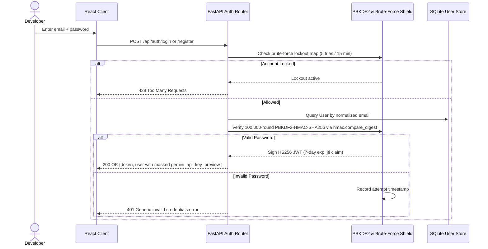
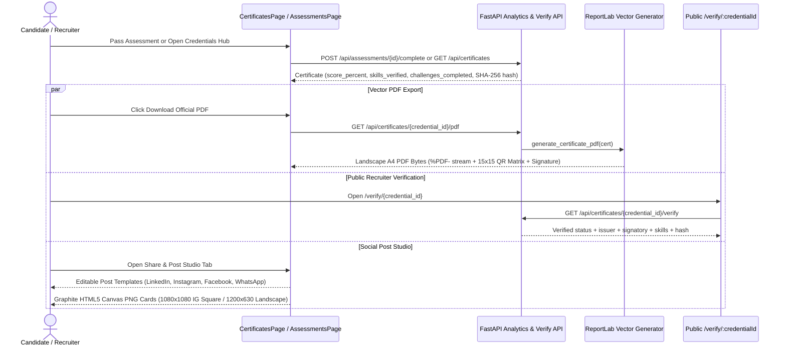

  

# Zero-Trust Security, ReportLab PDF & Social Credentials

[← Back to Wiki Home](Home.md)

---

## Zero-Trust Authentication & Account Shield Sequence

Authentication logic in [`backend/app/routers/auth.py`](../backend/app/routers/auth.py) enforces strict password strength, per-user salted PBKDF2 derivation, constant-time signature comparison, failed-attempt rate lockouts, and masked API key serialization in [`backend/app/routers/user.py`](../backend/app/routers/user.py).

---

## Certificate Lifecycle: ReportLab PDF, Public Verification & Social Studio

Credentials follow a deterministic cryptographic pipeline across [`backend/app/routers/assessments.py`](../backend/app/routers/assessments.py), [`backend/app/routers/analytics.py`](../backend/app/routers/analytics.py), [`backend/app/services/pdf_certificate.py`](../backend/app/services/pdf_certificate.py), and [`frontend/src/utils/certificateShare.ts`](../frontend/src/utils/certificateShare.ts).

---

## Supported Social Share Outputs

| Channel | Copyable Message Template | Graphic Attachment | Direct Action Deep-Link |
| :--- | :--- | :--- | :--- |
| **LinkedIn** | Career milestone post, score, verified skills, verify link & hashtags | `1200×630` PNG Card | **Post on Feed** (`linkedin.com/feed/?shareActive=true`) & **Add License/Cert** (`linkedin.com/profile/add`) |
| **Instagram** | Caption with metrics, skill stack & hashtag set | `1080×1080` Square PNG Card | **Download 1080×1080 Card** + Copy & Open Instagram |
| **Facebook** | Conversational milestone announcement + credential link | `1200×630` Landscape PNG Card | **Share on Facebook** (`facebook.com/sharer/sharer.php`) |
| **WhatsApp** | Clean `*bold*` status/DM summary + `\`credential_id\`` | Official Vector PDF | **Send via WhatsApp** (`https://wa.me/?text=...`) |
