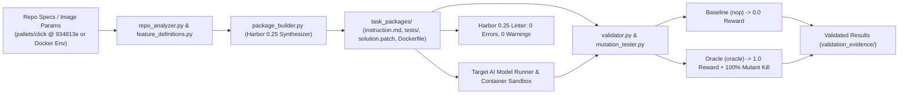
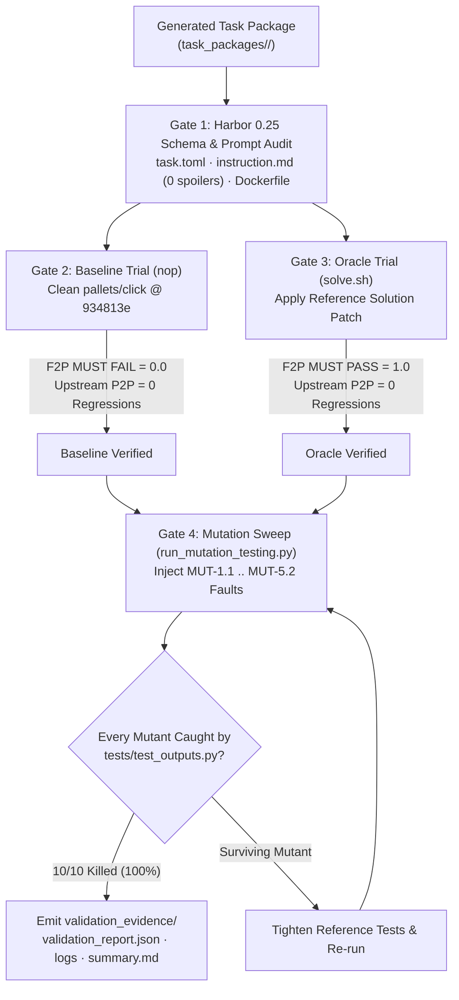

  

# Track 1: TaskForge Automated Harbor 0.25 Pipeline

[← Back to Wiki Home](Home.md)

---

## Pipeline Architecture (`TaskForge`)

Built inside [`pipeline/`](../pipeline/) to generate clean, zero-leakage SWE-bench feature tasks targeting **`pallets/click` v8.1.8** at base commit `934813e4d421071a1b3db3973c02fe2721359a6e`.

---

## Synthesized Feature Packages & Verification Scorecard

All evidence artifacts live in [`validation_evidence/`](../validation_evidence/):

| Package ID | Subsystem Modified | Baseline (`nop`) | Oracle (`oracle`) | Mutation Kill Rate | Harbor Lint |
| :--- | :--- | :---: | :---: | :---: | :---: |
| **`click-feature-command-aliases`** | Command dispatch (`core.py`) | `0.0` | `1.0` | 100% (2/2) | 0 errors |
| **`click-feature-json-help-export`** | Help formatting (`core.py`) | `0.0` | `1.0` | 100% (2/2) | 0 errors |
| **`click-feature-nested-envvar-prefix`** | Context resolution (`core.py`) | `0.0` | `1.0` | 100% (2/2) | 0 errors |
| **`click-feature-parameter-deprecation`** | Lifecycle warnings (`core.py`, `exceptions.py`) | `0.0` | `1.0` | 100% (2/2) | 0 errors |
| **`click-feature-password-minlen-validator`** | Input validation (`termui.py`, `core.py`) | `0.0` | `1.0` | 100% (2/2) | 0 errors |

---

## Harbor 0.25 Mutation Testing & Zero-Leakage Validation Matrix

Details the automated integrity gates executed by [`validate_tasks.py`](../validate_tasks.py) and [`run_mutation_testing.py`](../run_mutation_testing.py) to ensure zero pre-patch solution leakage, deterministic oracle passes, and 100% mutant kill rates.

For full architectural rationale and Harbor schema guarantees, see [`docs/TECHNICAL_EXPLANATION.md`](../docs/TECHNICAL_EXPLANATION.md) and [`docs/WALKTHROUGH_DEMO.md`](../docs/WALKTHROUGH_DEMO.md).
